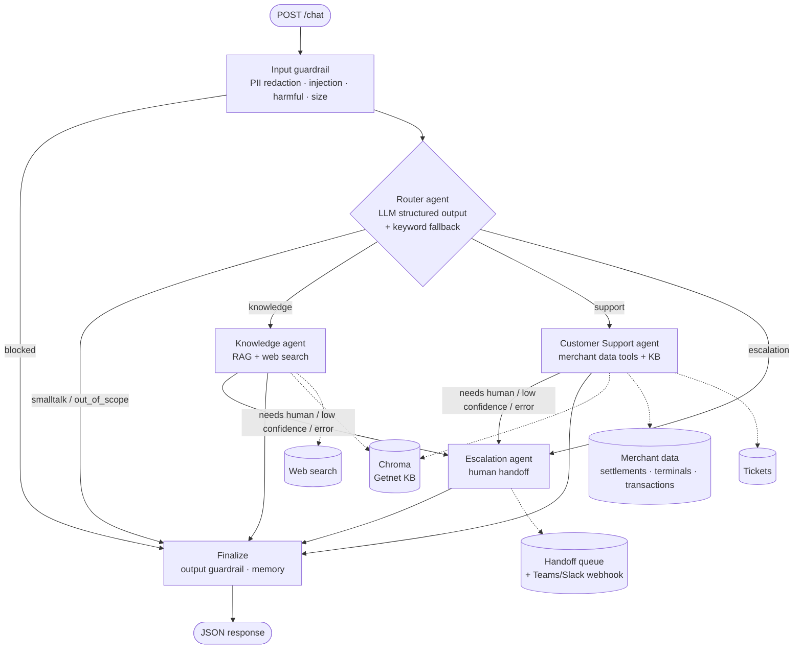
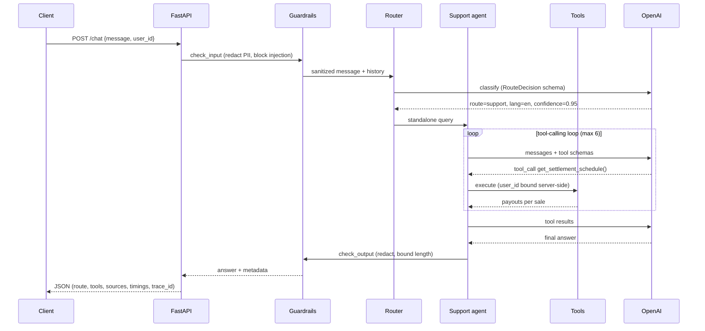

# Getnet Multi-Agent Support

A multi-agent customer support system for **Getnet** merchants. A **Router** agent reads each message and hands it to a specialist:

- a **Knowledge** agent, which uses RAG over Getnet's site and web search;
- a **Customer Support** agent, which uses tools over the merchant's own data;
- an **Escalation** agent, which hands the case to a human.

Deterministic guardrails run before and after the agents, and the whole thing is orchestrated with **LangGraph**, exposed through **FastAPI** and shipped with **Docker**.

```bash
cp .env.example .env            # add your OPENAI_API_KEY
docker compose up --build -d
curl -s localhost:8000/chat -H 'content-type: application/json' \
  -d '{"message": "When will the money from yesterday'\''s sales be deposited?", "user_id": "cliente1988"}' | jq
```

---

## Contents
1. [Quick start](#1-quick-start)
2. [API](#2-api)
3. [Architecture](#3-architecture)
4. [Message workflow](#4-message-workflow)
5. [The agents and their tools](#5-the-agents-and-their-tools)
6. [RAG pipeline](#6-rag-pipeline)
7. [Guardrails, human handoff and reliability](#7-guardrails-human-handoff-and-reliability)
8. [Testing strategy](#8-testing-strategy)
9. [Evaluation and observability](#9-evaluation-and-observability)
10. [Design decisions and trade-offs](#10-design-decisions-and-trade-offs)
11. [Project structure](#11-project-structure)
12. [Production roadmap](#12-production-roadmap)

---

## 1. Quick start

### Requirements
- Docker 24+ with Compose v2, **or** Python 3.11+
- An OpenAI API key (`gpt-4o-mini` + `text-embedding-3-small` by default)
- Optional: a Tavily key for higher-quality web search. DuckDuckGo is used by default and needs no key.

### Run with Docker (recommended)
```bash
cp .env.example .env                 # set OPENAI_API_KEY
docker compose up --build -d         # API on http://localhost:8000, docs on /docs
docker compose logs -f api           # structured JSON logs
```
On first start the knowledge base is built automatically. The curated seed corpus is indexed synchronously, so the API is usable right away; the live Getnet pages are then scraped in the background. The index lives in the `storage` volume, so restarts don't rebuild it. Check progress with `GET /ready`.

### Run locally
```bash
python -m venv .venv && source .venv/bin/activate
pip install -r requirements-dev.txt
cp .env.example .env                 # set OPENAI_API_KEY
python -m app.rag.store              # optional: build the index up front (add --no-web to skip scraping)
uvicorn app.main:app --reload        # or: make run
```

### Run the tests
```bash
pytest                               # 70 offline tests (fake LLM, no API key, ~2 s)
RUN_LIVE=1 pytest -m live            # the 10 challenge scenarios against the real model
python -m evals.run_evals            # full evaluation with LLM-as-judge (needs the key)
python -m evals.run_evals --fake     # evaluation pipeline smoke run, offline
docker compose run --rm -e OPENAI_API_KEY= api pytest   # tests inside the container
```

### Configuration
All settings are environment variables, typed in `app/core/config.py`. The main ones:

| Variable | Default | Purpose |
|---|---|---|
| `OPENAI_API_KEY` | — | Required for chat + embeddings |
| `CHAT_MODEL` / `ROUTER_MODEL` | `gpt-4o-mini` | Agent model; the router can use a cheaper one |
| `EMBEDDING_MODEL` | `text-embedding-3-small` | Multilingual embeddings (PT/EN) |
| `INGEST_ON_STARTUP` / `INGEST_SCRAPE_WEB` | `true` / `true` | Build the index on first boot / also scrape getnet sites |
| `RAG_TOP_K` / `RAG_MIN_RELEVANCE` | `5` / `0.30` | Retrieval breadth and relevance cut-off |
| `WEB_SEARCH_PROVIDER` | `duckduckgo` | `duckduckgo`, `tavily` or `none` |
| `HANDOFF_WEBHOOK_URL` | — | Teams/Slack incoming webhook to page a human on escalation |
| `LANGSMITH_TRACING` | — | Set to `true` (with `LANGSMITH_API_KEY`) for full traces |
| `ADMIN_TOKEN` | — | Protects `POST /admin/ingest` |

---

## 2. API

| Method | Path | Description |
|---|---|---|
| `POST` | `/chat` | Main endpoint: `{"message", "user_id", "session_id?"}` |
| `GET` | `/health` | Liveness |
| `GET` | `/ready` | Readiness: index size, LLM configured, ingestion status |
| `GET` | `/metrics` | Prometheus metrics |
| `POST` | `/admin/ingest?scrape_web=true` | Rebuild the knowledge base |
| `GET` | `/docs` | OpenAPI / Swagger UI |

**Request**
```json
{ "message": "My card machine won't connect to the internet, what should I do?", "user_id": "cliente1988" }
```

**Response** (illustrative)
```json
{
  "response": "Your Get Clássica (GC-3310-1187) has been offline for about 3 hours: the 3G signal is weak, the battery is at 18% and Wi-Fi was never configured. Try this:\n1. Charge it for at least 3 hours...\n2. Restart it...\n3. Configure your Wi-Fi network...\n4. Run the communication test: F > 60 > 2 Manutenção > 1 Teste de comunicação.\nYour Get Smart is online, so you can keep selling with it meanwhile. If the Get Clássica still won't connect, I can open a ticket for a replacement.",
  "user_id": "cliente1988",
  "session_id": "default",
  "trace_id": "5f0c1c0e4e6a4f0f9d3e0b8f2f6c7a11",
  "route": "support",
  "agent": "support",
  "language": "en",
  "confidence": 0.9,
  "sources": [{"title": "Technical support - card machine connectivity...", "url": "https://site.getnet.com.br/duvidas/algar/", "kind": "knowledge_base", "score": 0.71}],
  "tool_calls": [
    {"tool": "get_terminal_diagnostics", "args": {}, "status": "ok", "latency_ms": 2, "summary": "..."},
    {"tool": "search_getnet_knowledge_base", "args": {"query": "maquininha sem conexão internet"}, "status": "ok", "latency_ms": 180, "summary": "..."}
  ],
  "escalated": false,
  "handoff": null,
  "ticket": null,
  "guardrails": {"flags": [], "blocked": false, "reason": null},
  "routing": {"confidence": 0.95, "reasoning": "User reports a problem with their own machine.", "fallback": false},
  "path": ["input_guardrail", "router", "support_agent", "finalize"],
  "timings_ms": {"input_guardrail": 0, "router": 640, "support_agent": 3120, "finalize": 0, "total": 3790}
}
```

The response carries the routing decision, every tool call, the sources, guardrail flags, any handoff and per-node timings. That makes it debuggable from the client side, and it's the same data the evaluation harness scores.

**Mock merchants.** `cliente1988` is a bakery in Porto Alegre with a Get Smart (online) and a Get Clássica (offline), yesterday's sales and some declined transactions. `cliente2024` is an MEI on Get Tap. Any other `user_id` exercises the "merchant not found" path. Transaction dates are relative to today, so "yesterday's sales" always exist.

---

## 3. Architecture



**How the agents communicate.** The agents share a typed `SupportState` that flows through a LangGraph `StateGraph`. Each node reads the state and returns a partial update, and conditional edges decide the next node. This is an explicit, inspectable state machine: no free-form agent-to-agent chat, and no hidden control flow. Inside a specialist, the agent and its tools share an `AgentContext` that the tools write into (sources found, escalation requested, ticket created). The graph reads it back afterwards to decide whether to escalate.

**Conversation memory.** A LangGraph checkpointer keeps the message history per `user_id:session_id` thread. That lets "and what are the fees?" be resolved against the previous turn: the router rewrites it into a self-contained `standalone_query` for the specialist. `InMemorySaver` is used here; production would use Redis or Postgres.

---

## 4. Message workflow



1. **Input guardrail.** Empty or oversized input, prompt injection and fraud-enabling requests are blocked before any LLM call. Card numbers (Luhn-validated), CPFs (check-digit validated), CVVs and passwords are redacted, so they never reach the model or the logs.
2. **Router.** One structured-output call returns `route`, `confidence`, `language`, `reasoning`, a `standalone_query` and, for smalltalk or out-of-scope, a `direct_reply`. Smalltalk and out-of-scope messages are answered here and never touch a specialist. If the router labels something out-of-scope with low confidence, it goes to the Knowledge agent instead: a wrongly refused legitimate question costs more than a polite decline from the specialist.
3. **Specialist.** The Knowledge or Support agent runs a bounded tool-calling loop.
4. **Escalation (conditional).** Triggered by the router (the user asked for a human, or reported fraud), by an agent calling `request_human_agent`, by low answer confidence, or by an agent error.
5. **Finalize.** The output guardrail runs, the security notice is added if PII was redacted, and the answer is saved to memory.

---

## 5. The agents and their tools

### Router agent (`app/agents/router.py`)
- **Output:** a Pydantic `RouteDecision` via `with_structured_output`, so the model can't return malformed routes.
- **Prompt** (`app/prompts/router.py`): route definitions, tie-breakers (possessives such as *my machine* or *minhas vendas* signal support), and few-shot examples taken from the challenge scenarios.
- **Fallback:** a deterministic keyword router covering PT and EN. If the LLM call fails or times out, routing still works and the response is marked `routing.fallback=true`.

### Knowledge agent
| Tool | What it does |
|---|---|
| `search_getnet_knowledge_base(query)` | Semantic search over the Getnet corpus; returns passages, source URLs and relevance scores |
| `search_web(query)` | General and real-time information (weather, exchange rates, news) via DuckDuckGo or Tavily |
| `request_human_agent(reason, priority)` | Hands off to a human when the question needs account access or the user asks |

The prompt requires grounding ("never invent fees, deadlines or installment limits"), says when to use the KB versus the web, caveats prices that may change, and asks for an answer in the user's language.

### Customer Support agent: 6 data tools plus KB and handoff
| Tool | Example question |
|---|---|
| `get_merchant_profile()` | "Which plan am I on? What's my debit fee?" |
| `get_settlement_schedule(sale_date?)` | "When will yesterday's sales be deposited?" Computes payouts per sale using the merchant's plan (debit D+1, credit D+2, Pix instant, merchant-financed installments D+31 then every 30 days) and a Brazilian business-day calendar that includes Carnival, Good Friday, Corpus Christi and Consciência Negra |
| `get_terminal_diagnostics(serial?)` | "My machine won't connect." Returns status, signal, Wi-Fi, battery and firmware |
| `get_recent_transactions(status?, days?)` | "I'm getting declines." Returns recent sales with decline codes |
| `explain_decline_code(code)` | Meaning, who's responsible (issuer, cardholder, merchant) and what to do |
| `create_support_ticket(category, description)` | Back-office follow-up, such as a hardware replacement |
| `search_getnet_knowledge_base(query)` | Official troubleshooting steps |
| `request_human_agent(reason, priority)` | Fraud, disputes, past-day cancellations, unresolved issues |

**Security by construction.** `user_id` is bound server-side through a closure, so no tool takes a merchant id argument. "Show me cliente2024's sales" therefore can't leak data, whatever the prompt says, and a unit test asserts it.

### Escalation agent
Writes an operator summary in Portuguese for the internal team and a user message in the user's language containing the protocol number. It appends a `human_handoff` record (priority, reason, `trace_id`) to the handoff queue and, if `HANDOFF_WEBHOOK_URL` is set, posts it to Teams or Slack. If the LLM is down, a templated message is used, so a handoff always happens.

---

## 6. RAG pipeline

```
Ingestion ─► Cleaning ─► Chunking ─► Embedding ─► Storage ─► Retrieval ─► Generation
```

| Stage | Implementation |
|---|---|
| **Sources** | (1) A **curated seed corpus**: 8 markdown docs in `data/knowledge_base/`, written from the official Getnet pages, each with source URLs in its front matter. (2) **30 live URLs** (`app/rag/sources.py`) from `getnet.net/en` (the suggested source, which is mostly institutional) plus `site.getnet.com.br` product pages and help-centre FAQs, where the scenario products (Get Smart, Pix, Crediário, Link de Pagamento, antecipação) actually live |
| **Ingestion** | `WebScraper` with httpx + BeautifulSoup. It honours `robots.txt`, sends a descriptive User-Agent and strips nav, footer, scripts and cookie banners |
| **Chunking** | Markdown-header-aware split, then a recursive character split (900 chars, 150 overlap). Each chunk is prefixed with `[doc title - section path]` so it carries its context |
| **Embedding** | OpenAI `text-embedding-3-small`, which is multilingual, so PT questions match EN docs and vice versa. A deterministic `HashEmbeddings` is used for offline tests |
| **Storage** | Chroma (cosine), persisted to a Docker volume. Chunk ids are content hashes, so re-ingesting is **idempotent** |
| **Retrieval** | Similarity search with relevance scores, top-k=5, a relevance threshold of 0.30 and near-duplicate removal |
| **Generation** | The agent decides when and how to search (it can rephrase and search again), then answers grounded in the passages. Sources and scores are returned to the client and feed the answer confidence |

**Why a seed corpus plus scraping?** The Getnet sites are JavaScript-heavy marketing pages, and parts of them disallow crawlers. A curated, versioned corpus (with `last_reviewed` dates) gives a reliable, testable baseline; scraping keeps it fresh. In production the curated docs would come from the help-centre CMS.

---

## 7. Guardrails, human handoff and reliability

| Risk | Mitigation |
|---|---|
| Sensitive data (card, CPF, CVV, password) | Validated detection (Luhn, CPF check digits), redaction **before** the LLM and logs, and a security notice to the user. The output guardrail redacts again |
| Prompt injection / jailbreak | Pattern-based block before the LLM (`ignore previous instructions`, `reveal system prompt`, role tags). The test asserts the LLM is never called |
| Fraud-enabling / harmful requests | Blocked (card cloning, bypassing antifraud, laundering) with an offer to report fraud |
| Off-topic | Router `out_of_scope` route, answered with a polite scope statement |
| Cross-account access | Tools are user-scoped server-side; references to other merchant ids are flagged |
| Hallucinated fees or deadlines | Grounding rules in the prompts, sources returned, and a confidence score derived from retrieval evidence |
| Low confidence / can't resolve | Automatic **human handoff**, with protocol, operator summary and a webhook page |
| LLM outage / timeouts | Router keyword fallback; agent errors become a handoff instead of a 500; template messages; client timeouts and retries |
| Runaway agent loops | Max tool iterations per agent, then a forced final answer |
| Cost / abuse | Input size limit, bounded iterations, a cheaper router model option, token metrics per agent |

Rule-based guardrails are a deliberate first layer: fast, free, deterministic and auditable. The next layer for production would be a moderation or LLM classifier (OpenAI moderation, Llama Guard) for nuanced unsafe content, plus a groundedness check (an NLI or LLM judge comparing the answer to retrieved passages) on the Knowledge path.

---

## 8. Testing strategy

```
          ▲  live E2E (pytest -m live)       - real LLM, the 10 challenge scenarios
         ▲▲  evaluation (evals/)             - 20 labelled cases, route/tool/keyword/safety/judge metrics
       ▲▲▲▲  integration (tests/integration) - full LangGraph + API with a deterministic fake LLM
   ▲▲▲▲▲▲▲▲  unit (tests/unit)               - guardrails, tools, settlement math, router fallback, RAG
```

**Unit (fast, deterministic).** Guardrail detectors, including false-positive checks ("the PIN is incorrect" is not redacted). Settlement calculations and Brazilian holidays. User scoping of the tools. Decline codes. Ticket persistence. Chunking metadata. Retrieval returning the right document for each scenario. Idempotent ingestion. Scraper text extraction.

**Integration: the orchestration itself.** The key piece is `tests/fakes.py::PolicyChatModel`, a deterministic chat model that implements `bind_tools` and `with_structured_output`, picks tools by rule and records every prompt it receives. With it, the **real** graph, guardrails, Chroma, repository, tools and handoff store all run offline in about a second, so we can assert on:
- **Routing and paths:** every scenario takes the expected `path`, e.g. `input_guardrail → router → support_agent → finalize`.
- **Trajectories:** the expected tools are called in order (`get_recent_transactions → explain_decline_code`).
- **Data correctness:** the settlement answer contains the D+2 payout date computed from the mock ledger.
- **Safety:** an injection never reaches the LLM (`fake_llm.calls == []`), and a card number never appears in any prompt.
- **Escalation:** explicit requests, agent-requested handoffs (high priority for unauthorized refunds), and handoff records written to the queue.
- **Failure injection:** an agent outage degrades to a handoff; a total LLM outage still routes through the fallback and answers with the template.
- **Memory:** the second turn sees the first, and a different session doesn't.
- **API contract:** schema, validation (422), trace-id propagation, a 503 without a key, and metrics exposure.

**Comprehensive integration testing in production.** I would add:
1. **Contract tests** per tool against the real internal APIs (settlement, terminals), run against a staging environment.
2. **Recorded-LLM tests** (VCR-style cassettes) to replay real model outputs deterministically in CI.
3. **Live scenario suites** on a schedule and before each prompt or model change, gated by the eval thresholds below.
4. **Load tests** (Locust/k6) on `/chat` to size workers and check p95 under concurrency.
5. **Chaos tests:** LLM 429s and timeouts, slow vector store, web search down, asserting graceful degradation.
6. **Red-team suites:** jailbreak and PII corpora run as regression tests.

---

## 9. Evaluation and observability

### Offline evaluation (`evals/`)
`evals/dataset.jsonl` has 20 labelled cases: the 10 challenge scenarios plus Portuguese variants, escalation, guardrail, out-of-scope, cross-account and unknown-merchant cases. Each case carries `expected_route`, `expected_tools`, `must_contain_any`, `must_not_contain`, `expect_escalation`, `expect_language` and a `reference` answer. `python -m evals.run_evals` reports:

| Metric | Measures |
|---|---|
| `route_accuracy` | Router quality |
| `tool_recall` | Agent trajectory: did it call the right tools? |
| `keyword_hit` | Key facts present (e.g. "48" for crediário) |
| `safety_pass` | No PII or other merchants' data in answers (must be 100%) |
| `escalation_accuracy` / `language_accuracy` | Handoff precision; answer in the user's language |
| `judge_score` | LLM-as-judge, 1–5, on correctness vs reference, groundedness and helpfulness |
| `latency_p50/p95`, `mean_confidence` | Performance and calibration |

Reports go to `evals/results/*.md|json`. The script **exits non-zero below the thresholds** (route accuracy ≥ 0.85, safety = 100%), so it works as a CI or release quality gate. The offline `--fake` mode runs in CI on every push and measures the keyword fallback alone, which scores 0.90 route accuracy. The two cases it misses (a poem request and a cross-account request) need semantic understanding, which is what the LLM router is for.

### Observability
- **Structured logs** (structlog, JSON). Every line carries a `trace_id`, which is accepted from or returned in the `x-trace-id` header. Events: `router.decision`, `tool.called`, `node.completed` (with latency), `guardrail.blocked`, `handoff.created`, `chat.completed`.
- **Prometheus metrics** (`/metrics`): `chat_requests_total{route,status}`, `chat_request_latency_seconds{route}`, `graph_node_latency_seconds{node}`, `agent_tool_calls_total{agent,tool,status}`, `guardrail_events_total{stage,flag}`, `escalations_total{reason}`, `rag_retrieved_chunks`, `llm_tokens_total{agent,kind}`.
- **Tracing:** set `LANGSMITH_TRACING=true` and every graph node, LLM call (prompt, tokens, latency) and tool call becomes a nested trace tagged with `user_id` and `trace_id`. Langfuse is a drop-in, self-hostable alternative.
- **Per-response diagnostics:** `path`, `timings_ms`, `tool_calls`, `sources`, `routing` and `confidence` in every API response.

### Production monitoring and alerting
| Dashboard / alert | Signal |
|---|---|
| Traffic & latency | p95 `/chat` > 10 s; error rate > 2% |
| Routing mix drift | Sudden change in the route distribution; router fallback rate > 5% (LLM issues) |
| Quality | Escalation rate, low-confidence rate, zero-retrieval rate (KB gaps), user thumbs-down |
| Safety | Spikes in `guardrail_events_total` (attack campaigns), any `output_pii_*` |
| Cost | Tokens per request and per agent; tool-iteration distribution |
| Tools | Error rate per tool (backend health) |

**Continuous improvement loop.** Sample production traces, especially escalations, low-confidence answers and negative feedback, review them with an LLM judge plus humans, and add them to the eval dataset. Prompt, model or KB changes must pass the eval gate before release.

---

## 10. Design decisions and trade-offs

- **LangGraph state machine over free-form multi-agent chat.** Routing, escalation and failure handling are explicit edges, so behaviour is predictable, testable node by node and easy to trace. Agents stay narrow, which keeps prompts and tool sets focused.
- **In-house tool loop instead of a prebuilt ReAct agent.** It's about 80 lines and gives full control over iteration limits, error handling (tool errors go back to the model), per-tool metrics and the `tool_calls` trace in the API response.
- **Router as one structured-output call.** It's cheap and fast (a smaller model can be configured), and it also detects language and rewrites the query for multi-turn context. The keyword fallback keeps the service up during LLM incidents.
- **Weather and exchange rates go to the Knowledge agent.** The brief asks for web search for general-purpose questions, so these are in scope; genuinely unrelated requests (poems, homework) are declined.
- **Support agent can also read the KB.** Real support questions mix account data with official procedures, such as connectivity troubleshooting, without an extra hop through another agent.
- **Deterministic guardrails first.** Zero latency, zero cost and fully testable; an LLM moderation layer can be added on top.
- **Confidence is heuristic.** It's derived from retrieval scores and tool success, not the LLM's self-assessment. It's simple, explainable and drives the low-confidence handoff; calibrating it against eval data is a roadmap item.
- **Mock data behind a repository interface.** Tools depend on `CustomerRepository`, so swapping in real internal APIs doesn't change the agents.

---

## 11. Project structure

```
app/
  main.py                  FastAPI app: /chat, /health, /ready, /metrics, /admin/ingest
  api/schemas.py           Request/response models
  core/                    config (pydantic-settings), structured logging + trace ids, Prometheus metrics
  llm/factory.py           Chat/embedding model factory (OpenAI; hash embeddings for tests)
  graph/                   LangGraph state + orchestrator (nodes, edges, memory)
  agents/                  base tool-calling loop, router, knowledge/support/escalation agents
  prompts/                 system prompts for every agent
  tools/                   knowledge-base, web-search, support and escalation tools
  guardrails/checks.py     input/output guardrails
  rag/                     sources, loaders/scraper, chunking, Chroma store, ingestion CLI
  services/                customer repository, settlement business days, tickets/handoff queue
data/
  knowledge_base/*.md      curated Getnet corpus (with source URLs)
  customers.json           mock merchants (relative dates)
  decline_codes.json       authorization response codes
evals/                     labelled dataset + evaluation runner (metrics, judge, quality gate)
tests/                     unit, integration (fake LLM) and live suites
Dockerfile, docker-compose.yml, Makefile, .github/workflows/ci.yml
```

---

## 12. Production roadmap
- Persistent checkpointer (Redis/Postgres) and horizontal scaling. The API is otherwise stateless.
- Authentication: `user_id` taken from a verified token instead of the request body.
- Hybrid retrieval (BM25 + vectors) with a re-ranker; scheduled re-ingestion with change detection.
- Streaming responses (SSE) for perceived latency.
- LLM-based moderation and groundedness checks; calibrated confidence.
- Real ticketing integration (Zendesk/ServiceNow) and a live human-agent channel (Teams bot) for two-way handoff.

---

*The knowledge base content was compiled from Getnet's public pages (getnet.net, site.getnet.com.br) for this technical challenge. Fees and conditions change; the assistant always points users to the official channels to confirm them.*
